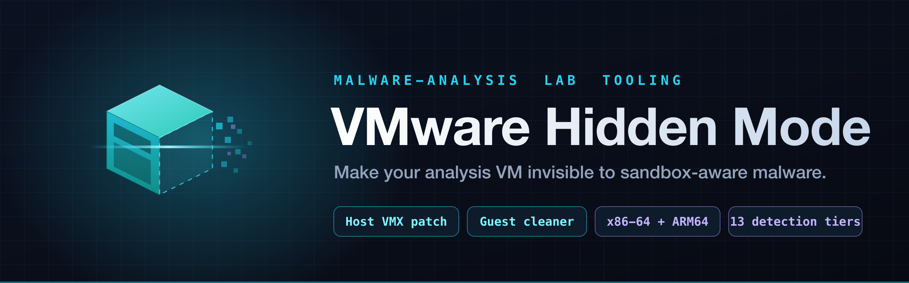
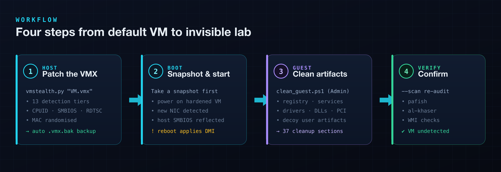
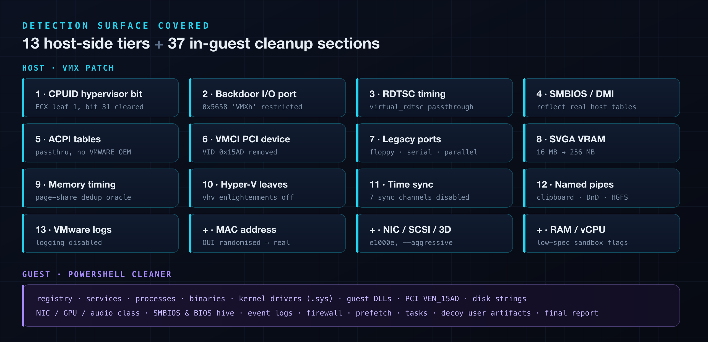
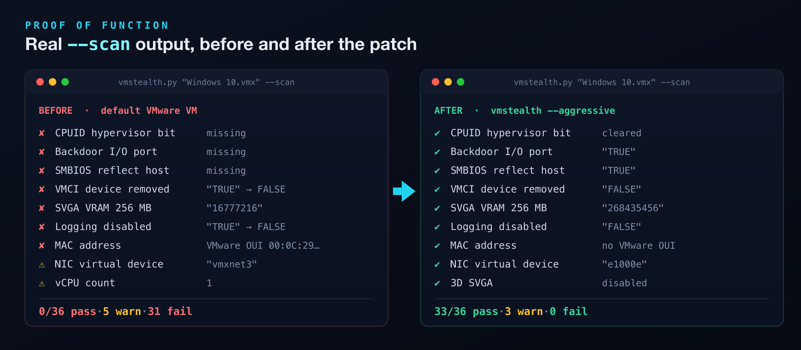

<div align="center">



<br>

**Harden a VMware analysis VM so sandbox-aware malware can't tell it's virtualised — and behaves like it's on real hardware.**

[](https://github.com/at0m-b0mb/VMware-Hidden-Mode/releases)
[](LICENSE)
[](https://www.python.org/)
[](#)
[](#)

</div>

---

> [!WARNING]
> **For authorised malware-analysis, reverse-engineering, and security research only.**
> Run these tools **only against VMs you own**. Always take a snapshot before running the
> guest cleaner. See [SECURITY.md](SECURITY.md) for responsible-use guidance. The authors
> accept no liability for damage caused.

---

## Overview

Sandbox-aware malware refuses to detonate when it detects a VM. Before analysis, it probes
dozens of signals — the CPUID hypervisor bit, VMware's SMBIOS/DMI strings, the backdoor I/O
port, VMCI PCI devices, RDTSC timing, driver names, registry keys, MAC OUIs, and more — and
if any say *"VMware"*, it hides its real behaviour.

**VMware Hidden Mode** removes or masks those signals across two layers:

- **Host layer** — a Python patcher edits the `.vmx` config *before boot* (CPUID masks, SMBIOS
  host-reflection, backdoor lockdown, device removal, MAC randomisation, and more).
- **Guest layer** — a PowerShell cleaner scrubs artifacts *inside Windows* (registry, services,
  drivers, DLLs, hardware strings, event logs) and plants realistic decoy user activity.

The result: a VM that looks like a used, physical workstation to the software under test.

<div align="center">

</div>

---

## The suite

| File | Layer | Target | Host |
|------|-------|--------|------|
| [`vmstealth.py`](vmstealth.py) | Host (VMX) | — | VMware Workstation / Fusion on **Intel** |
| [`vmstealth_fusion_arm.py`](vmstealth_fusion_arm.py) | Host (VMX) | — | VMware Fusion 13+ on **Apple Silicon** |
| [`clean_guest.ps1`](clean_guest.ps1) | Guest | Windows 10/11 **x86-64** | — |
| [`clean_guest_arm.ps1`](clean_guest_arm.ps1) | Guest | Windows 11 **ARM64** | — |

You use **one host script + one guest script**, matched to your CPU architecture.

---

## Detection surface covered

<div align="center">

</div>

The host patcher exposes an audit mode (`--scan`) that grades every tier, and an apply mode
that fixes them. The guest cleaner walks 37 numbered sections and prints a colour-coded
verification report at the end.

---

## Proof it works

Running `--scan` against a stock VMware "Windows 10" profile before and after the patch:

<div align="center">

</div>

The three remaining warnings after patching (vCPU count, RAM, SCSI controller type) are
hardware choices you set in the VMware VM settings UI, not `.vmx` stealth flags — bump the VM
to ≥ 2 vCPUs / ≥ 4 GB RAM and they clear too.

---

## Quick start

### 1 · Requirements

| | |
|---|---|
| **Host** | VMware Workstation 16+ **or** VMware Fusion 13+ · Python **3.9+** |
| **Guest** | Windows 10/11 (x64) or Windows 11 (ARM64), **PowerShell 5.1 or 7+** |
| **Privileges** | Host script: normal user · Guest script: **Administrator** |
| **Before you start** | **Take a VM snapshot.** The host patcher also writes a `*.vmx.bak` automatically. |

### 2 · Patch the VMX on the host — *VM must be shut down*

**Intel (VMware Workstation / Fusion):**

```bash
# Audit only — grade the VMX without changing it
python3 vmstealth.py "Windows 10.vmx" --scan

# Apply all stealth settings + copy the guest script out
python3 vmstealth.py "Windows 10.vmx" --guest-script clean_guest.ps1

# Go further: swap NIC to e1000e, disable 3D SVGA, remove xHCI USB
python3 vmstealth.py "Windows 10.vmx" --aggressive --guest-script clean_guest.ps1
```

**Apple Silicon (VMware Fusion):** accepts the `.vmwarevm` bundle *or* the raw `.vmx`.

```bash
python3 vmstealth_fusion_arm.py "Windows 11.vmwarevm" --scan
python3 vmstealth_fusion_arm.py "Windows 11.vmwarevm" --guest-script clean_guest_arm.ps1
```

### 3 · Clean the guest — *inside Windows, as Administrator*

Transfer the matching `clean_guest*.ps1` into the VM, open **PowerShell as Administrator**, then:

```powershell
powershell -ExecutionPolicy Bypass -File .\clean_guest.ps1      # x64
powershell -ExecutionPolicy Bypass -File .\clean_guest_arm.ps1  # ARM64
```

Read the colour-coded output, then **reboot** so the SMBIOS/DMI changes take effect:

| Tag | Meaning |
|-----|---------|
| `[+]` green | action completed |
| `[-]` grey | item not present / skipped |
| `[!]` yellow | warning — review manually |
| `[X]` red | action failed |

### 4 · Verify

The cleaners set a plausible OEM identity — **Lenovo ThinkPad T490** on x64,
**Dell OptiPlex 7090** on ARM64 — and Intel UHD Graphics 630 for the display. Nothing should
report VMware:

```powershell
Get-CimInstance Win32_ComputerSystem  | Select-Object Manufacturer, Model      # → LENOVO / ThinkPad T490 (x64)
Get-CimInstance Win32_BIOS            | Select-Object Manufacturer, SMBIOSBIOSVersion
Get-CimInstance Win32_VideoController | Select-Object Name                     # → Intel UHD Graphics 630
Test-Path "HKLM:\SOFTWARE\VMware, Inc."                                        # → False
Test-Path "HKLM:\SYSTEM\CurrentControlSet\Services\VMTools"                    # → False
```

Then run **[pafish](https://github.com/a0rtega/pafish)** or **[al-khaser](https://github.com/LordNoteworthy/al-khaser)**
inside the guest to confirm the VM is no longer flagged.

---

## What the guest cleaner does

The x64 cleaner ([`clean_guest.ps1`](clean_guest.ps1)) runs 37 numbered sections; the ARM
cleaner mirrors them and adds an Apple-SMBIOS → Dell identity patch up front. Highlights:

| Group | Sections |
|-------|----------|
| **Software identity** | VMware registry keys, services, processes, uninstall entries |
| **Binaries & drivers** | rename VMware `.exe` / `.sys` / `.dll` to generic Windows names |
| **Hardware strings** | PCI `VEN_15AD`, SCSI/IDE, NIC, GPU, audio, SMBIOS/BIOS hive |
| **Forensic hygiene** | prefetch, scheduled tasks, event logs, firewall rules, env vars |
| **Realism** | decoy documents with backdated timestamps, browser profile stubs, startup entries, RAM/CPU/disk/uptime sanity checks |
| **Report** | final WMI verification pass, colour-coded pass/warn/fail summary |

---

## Known limitations (Apple Silicon)

| Limitation | Why |
|------------|-----|
| **ARM64 architecture code (`12`)** | `Win32_Processor.Architecture` returns `12` for ARM64. Native ARM64 processes can read it; this can't be changed from inside the guest. x86/x64 malware under WoW64/Prism sees `9` and is unaffected. |
| **SMBIOS reflects Apple data** | `SMBIOS.reflectHost` on Apple Silicon passes *Apple* strings into the guest — the ARM cleaner's Section 0 rewrites them to a Dell identity. A reboot is required before WMI reflects the change. |
| **HVCI / Secure Boot** | can block in-use driver renames — the script warns and asks you to reboot first. |
| **VMware Tools re-install** | restores many patched values; re-run the cleaner afterward. |
| **NAT networking** | uses `192.168.x.2` gateways that fingerprint VMware — prefer **Bridged** mode. |

---

## Troubleshooting PowerShell parse errors

Seeing `Variable reference is not valid` or `Unexpected token 'VMware'`? Two causes, both
already fixed in the shipped scripts:

1. **UTF-8 without BOM** — Windows PowerShell 5.1 misreads the non-ASCII output characters.
   The scripts ship **with** a UTF-8 BOM (`EF BB BF`). Verify:
   ```powershell
   $b = [System.IO.File]::ReadAllBytes('.\clean_guest.ps1'); '{0:X2} {1:X2} {2:X2}' -f $b[0],$b[1],$b[2]
   # Should print: EF BB BF
   ```
2. **`$field:` interpolation** — PowerShell reads `"$name:"` as a PSDrive reference. The
   scripts use `${name}` throughout to avoid it.

If you edited a script and stripped the BOM, re-add it:
```powershell
$c = Get-Content '.\clean_guest.ps1' -Raw -Encoding UTF8
[System.IO.File]::WriteAllText((Resolve-Path '.\clean_guest.ps1'), $c, [System.Text.UTF8Encoding]::new($true))
```

---

## Project layout

```
VMware-Hidden-Mode/
├── vmstealth.py               # Host VMX patcher — Intel
├── vmstealth_fusion_arm.py    # Host VMX patcher — Apple Silicon
├── clean_guest.ps1            # Guest cleaner — Windows x64  (37 sections)
├── clean_guest_arm.ps1        # Guest cleaner — Windows ARM64
├── assets/                    # branding + diagrams
├── CHANGELOG.md
├── SECURITY.md
└── README.md
```

---

## Contributing

Found a detection vector the suite misses, or a check that reports a false "clean"? Open an
[issue](https://github.com/at0m-b0mb/VMware-Hidden-Mode/issues) with your VMware product +
version, guest OS + architecture, and the specific check involved. PRs welcome.

## License

[MIT](LICENSE) © [at0m-b0mb](https://github.com/at0m-b0mb)

<div align="center">
<br>
<sub>Built for the lab. Use responsibly.</sub>
</div>
